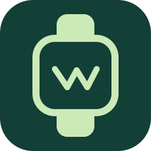

<div align="center">



# WatchBridge

**Prepara el modo desarrollador del Apple Watch e instala apps con Watch Companion en el reloj, desde Windows.**

[English](README.en.md) · [简体中文](README.md) · [한국어](README.ko.md) · [繁體中文](README.zh-TW.md) · [日本語](README.ja.md) · [Español](README.es.md) · [Français](README.fr.md) · [Deutsch](README.de.md) · [Português](README.pt.md)

[](https://github.com/AdminZachary/iloader-for-windows/actions/workflows/windows.yml)
[](LICENSE)


</div>

> [!IMPORTANT]
> WatchBridge es una derivación comunitaria independiente del [fork de iLoader de AndreySemjonov](https://github.com/AndreySemjonov/iloader); el proyecto original es [nab138/iLoader](https://github.com/nab138/iloader).
> **No es una versión oficial de Apple ni de ningún proyecto upstream, y no implica respaldo alguno.** Reporta los problemas en este repositorio, no upstream.

> [!NOTE]
> El flujo completo se ha verificado en un iPhone 17 Pro + Apple Watch Ultra 2 y en un iPhone 13 Pro + Apple Watch Series 7:
> preparación del modo desarrollador → firma → instalación en el teléfono → instalación en el reloj → arranque de la app.

## Qué es

Instalar una app iOS autofirmada (como hace SideStore) requiere tres cosas: firma con Apple ID, registrar el dispositivo de destino como dispositivo de desarrollo y activar el modo desarrollador en el dispositivo. La cadena de herramientas oficial es Xcode, que solo existe en macOS.

iLoader rehízo la mitad de eso en Windows con Rust. **WatchBridge añade la otra mitad**: toma el `Watch/*.app` que va dentro de la app instalada en el iPhone y lo lleva al Apple Watch emparejado; y antes de eso hace aparecer el interruptor de modo desarrollador del reloj. Sin instalar Python y sin línea de comandos.

El camino hacia el dispositivo es indirecto: Windows no ve el reloj, así que el programa usa el iPhone como enrutador, reenvía un puerto al reloj y realiza el emparejamiento, la lectura de estado y la instalación dentro de esa sesión reenviada.

## Funciones

| | Función | Detalle |
|---|---|---|
| 🛠 | **Preparación del modo desarrollador** | Emparejar el reloj → solicitar el interruptor → leer el estado. Solo se envía `action 0`; **activar, reiniciar y confirmar siempre lo haces tú en el reloj** |
| 📦 | **Instalación de Companion** | Comprueba que el IPA contenga el host de iPhone y `Watch/*.app`, lo vuelve a firmar, lo instala en el teléfono y después instala la app del reloj |
| 📶 | **Wi-Fi / RSD** | Configura el Wi-Fi una vez por USB y luego instala y renueva sin cable; la preparación del modo desarrollador sigue requiriendo USB |
| ♻️ | **Renovación automática** | Vuelve a firmar antes de que caduquen los 7 días, con control desde la bandeja y arranque opcional |
| 🔐 | **Cuenta y certificados** | Inicio de sesión con Apple ID (identidad del dispositivo vía anisette), consulta/revocación de certificados, gestión de App IDs, soporte de keyring |
| 🔗 | **Archivo de emparejamiento** | Importar/exportar pairing files, reparar el emparejamiento Wi-Fi |
| 🌍 | **Interfaz multiidioma** | 28 idiomas, incluidos chino simplificado y tradicional |

## Flujo de uso

```text
① Conecta el iPhone emparejado por USB   ② Empareja el reloj y confirma la confianza en él
   Selecciona el dispositivo                Solicita el interruptor «Modo desarrollador»
   ↓                                        ↓
   Actívalo en el reloj → reinicia → confirma → pulsa «Volver a comprobar»
   ↓
③ Inicia sesión con Apple ID → elige el IPA original → firma e instala
   ↓
   Abre la app en el reloj y confirma que arranca
```

> [!NOTE]
> El programa **no** activa el modo desarrollador, no reinicia el reloj ni confirma la confianza por ti. Los registros de confianza solo existen en memoria: al reiniciar el programa hay que establecer una sesión nueva.

## Requisitos

- Windows 10 22H2 / Windows 11 (x86_64)
- **Apple Mobile Device Service**: incluido en [iTunes](https://www.apple.com/itunes/) o en la app Apple Devices de Microsoft Store. Sin él no funcionan ni USB ni Wi-Fi
- Runtime de WebView2 (incluido en Windows 11)
- Un iPhone ya emparejado con el reloj de destino; la preparación requiere cable

## Instalación y ejecución

Descarga el artefacto `watchbridge-windows` del job `windows` en [Actions](https://github.com/AdminZachary/iloader-for-windows/actions/workflows/windows.yml), descomprímelo y ejecuta `WatchBridge.exe`.

El archivo contiene:

| Archivo | Contenido |
|---|---|
| `WatchBridge.exe` | La aplicación, **sin firmar**; SmartScreen avisará en el primer arranque |
| `BUILD.json` | Commit de origen, si el árbol estaba modificado, hashes de los lockfiles, versiones del toolchain y SHA-256 del exe |
| `SHA256SUMS.txt` | Sumas de verificación de los archivos anteriores |
| `LICENSES.zip` | Textos de licencias de terceros e inventario de dependencias (`inventory.json`) |

## Compilar desde el código

Las dependencias y el procedimiento completo están en [BUILDING.md](BUILDING.md). GitHub Actions compila, ejecuta las pruebas unitarias de Rust de `iloader` e `isideload` y genera el artefacto anterior.

```powershell
# Solo el frontend
bun install --frozen-lockfile --ignore-scripts
bun run build

# Compilación completa de Windows (pruebas + exe + sumas de verificación)
.\scripts\Build-Windows.ps1 -BuildExecutable
```

Añade `-SkipTests` para una compilación local rápida sin pruebas. La compilación debe ser nativa de Windows + MSVC; no se admite compilación cruzada.

## Compatibilidad y límites conocidos

| Límite | Detalle |
|---|---|
| **Un solo reloj** | Si un iPhone tiene varios relojes emparejados, la preparación se niega en lugar de adivinar. El protocolo de reenvío no tiene parámetro para «elegir el reloj», y actuar sobre el equivocado es peor que fallar |
| **Sin paquetes solo-Watch** | El IPA original debe contener el host de iPhone y `Watch/*.app` |
| **App Group** | Las apps que requieren un Watch App Group pueden seguir afectadas por el comportamiento upstream que omite esa asociación |
| **Versiones de sistema** | El flujo del reloj proviene de la implementación experimental de xtool; cada combinación de iOS/watchOS necesita validación en hardware |
| **Herramienta no oficial** | Sin jailbreak, sin saltarse la firma de Apple, sin certificados falsificados |

## Estado de validación

Siguiendo la terminología de la comunidad upstream para no mezclar evidencias de distinta fuerza:

| Nivel | Significado | Estado |
|---|---|---|
| `BUILD_VALIDATED` | Compila y las pruebas pasan | ✅ CI de Windows |
| `CI_VALIDATED` | La CI produce un artefacto descargable | ✅ |
| `IPHONE_INSTALLED` | La app se instala en el iPhone y arranca | ✅ en hardware |
| `WATCH_INSTALLED` | La app se instala en el reloj | ✅ en hardware |
| `PHYSICALLY_VALIDATED` | Cadena completa confirmada en hardware | ✅ 2026-11-12 |

Registro en hardware:

| Fecha | Paso | Dispositivos | Resultado |
|---|---|---|---|
| 2026-11-12 | Flujo completo: preparación → firma → instalación en teléfono → instalación en reloj → arranque | iPhone 17 Pro + Ultra 2 | ✅ Correcto |
| 2026-11-12 | Flujo completo | iPhone 13 Pro + Series 7 | ✅ Correcto |

La lista de verificación está en [docs/WATCHBRIDGE_TESTING.md](docs/WATCHBRIDGE_TESTING.md).

## Preguntas frecuentes

<details>
<summary><b><code>fail to connect to usbmuxd device socket: io error</code></b></summary>

En Windows, usbmuxd lo proporciona Apple Mobile Device Service y escucha en `127.0.0.1:27015`. Este error significa que nada responde en ese puerto: normalmente el servicio no está instalado o está detenido.

```powershell
Get-Service "Apple Mobile Device Service"      # debe existir y estar en Running
Test-NetConnection 127.0.0.1 -Port 27015       # debe ser True
$env:USBMUXD_SOCKET_ADDRESS                    # debe estar vacío
```

Si el servicio no existe, instala iTunes o la app Apple Devices. Si se sobrescribió la dirección, elimina esa variable de entorno. El programa **no incluye** usbmuxd; depende por completo del controlador y del servicio de Apple.
</details>

<details>
<summary><b>«No se puede leer la información del reloj»</b></summary>

Las versiones anteriores consultaban el nombre del reloj en el registro de emparejamiento del iPhone antes de emparejar; en versiones recientes de iOS esa consulta no devuelve nada. La versión actual establece primero la confianza con el reloj y lee su identidad de la propia sesión del reloj. Si sigue fallando, abre «Ajustes y registros → Ver registros» y revisa el valor `kind=` de `watch step failed`: `timed out` significa que el reloj no respondió; `NotFound` / `UnexpectedResponse` indican una diferencia de protocolo.
</details>

<details>
<summary><b>«Se han encontrado varios relojes emparejados»</b></summary>

Consulta el límite de un solo reloj. Confirma el reloj de destino en la app Watch del iPhone; apagar el otro reloj o alejarlo **no** lo elimina del registro de emparejamiento.
</details>

## Contribuir

- Reglas de contribución: [CONTRIBUTING.md](CONTRIBUTING.md)
- Upstream prohíbe explícitamente las contribuciones generadas por IA, así que **este repositorio nunca envía PRs upstream**. Mantén los cambios en este fork
- No adjuntes Apple IDs, contraseñas, claves privadas de certificados, registros de emparejamiento ni registros de dispositivo sin anonimizar

## Licencia y créditos

El código del proyecto se publica bajo MIT ([LICENSE](LICENSE)); las condiciones de marca están en [LICENSE-BRANDING](LICENSE-BRANDING).

> La biblioteca de firma de la cadena de dependencias (`apple-codesign-quick` de `apple-crates`) no declara licencia; sus términos siguen sin aclararse. Consulta [docs/LICENSE_REVIEW.md](docs/LICENSE_REVIEW.md).

Fuentes y atribución: [THIRD_PARTY_NOTICES.md](THIRD_PARTY_NOTICES.md), [vendor/isideload/PROVENANCE.md](vendor/isideload/PROVENANCE.md).

| Fuente | Contribución |
|---|---|
| [nab138/iLoader](https://github.com/nab138/iloader) | Aplicación original, cadena de firma e instalación |
| [AndreySemjonov/iloader](https://github.com/AndreySemjonov/iloader) | Punto de partida de este repositorio: Wi-Fi/RSD y renovación automática |
| [oacevedo/xtool](https://github.com/oacevedo/xtool/tree/feat/experimental-watchos) | Flujo de preparación del modo desarrollador (reescrito de forma nativa en Rust aquí, sin Python) |
| Data_C0re_ (Rzbck) | Firma, registro e instalación de Watch Companion |
| idevice / isideload y sus autores upstream | Comunicación con dispositivos e implementación de firma |

## Aviso legal

Este proyecto no está afiliado a Apple Inc. Apple, iPhone y Apple Watch son marcas de Apple Inc.

Solo para aprendizaje, investigación y desarrollo personal; cada usuario debe comprobar la legislación de su jurisdicción y las condiciones de licencia de las apps que instala. Los autores no asumen responsabilidad por daños al dispositivo, pérdida de datos, restricciones de cuenta o revocación de certificados.
